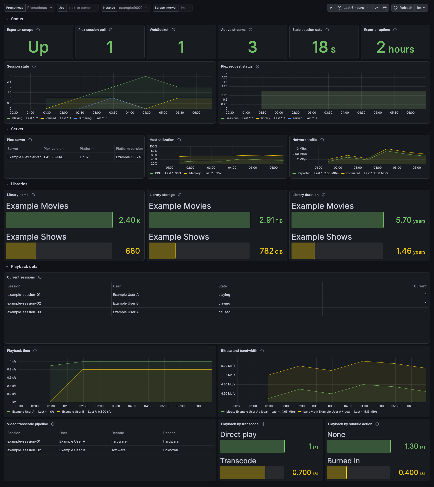

# plex-exporter

[](https://github.com/naterator/plex-exporter/actions/workflows/ci.yml)
[](LICENSE)

Plex metrics for Prometheus, with a Grafana dashboard. Tracks playback sessions,
transcodes, bandwidth, host utilization, and library counts and storage.



Grafana dashboard with example data.

## Run it

Set the Plex server URL and an admin token:

```bash
docker run -d \
  --name plex-exporter \
  --restart unless-stopped \
  -p 127.0.0.1:9000:9000 \
  -e PLEX_SERVER="http://192.168.1.100:32400" \
  -e PLEX_TOKEN="your-plex-token" \
  ghcr.io/naterator/plex-exporter:latest
```

The exporter serves metrics at `http://127.0.0.1:9000/metrics`. Add it to
Prometheus:

```yaml
scrape_configs:
  - job_name: plex
    scrape_interval: 30s
    static_configs:
      - targets: ["exporter-host:9000"]
```

Keep the metrics port on a trusted network. Session labels include usernames,
devices, and media titles, and the exporter doesn't authenticate requests.

For Kubernetes, create a Secret named `plex-exporter` with `server` and `token`
keys, then apply [`deploy/kubernetes.yaml`](deploy/kubernetes.yaml) in the same
namespace. Pin an image tag or digest for deployment. The example probes
`/healthz` so Prometheus can keep scraping diagnostics while Plex is down.

## Grafana

Import [`grafana/plex-exporter.json`](grafana/plex-exporter.json) through
Grafana's dashboard import screen. Choose your Prometheus data source, job, and
instance, then set the dashboard's scrape interval to match that job. The file
uses Grafana's built-in panels and has no fixed hostnames or data source UIDs.

The top panels show exporter availability, Plex request health, data age, and
session state. Playback, library, and traffic panels follow. Job and instance
choices work when no one is watching.

The dashboard separates current session gauges from retained playback counters.
Stopped sessions disappear from the active count immediately; their counters
stay briefly so Prometheus can collect the last sample. Watch-time charts show
sampled increments. A stream shorter than the scrape interval can be missed,
and those charts don't reconstruct Plex's watch history.

[`prometheus/alerts.yml`](prometheus/alerts.yml) has rules for exporter outages,
failed session requests, stale data, and repeated errors. Add the file to your
Prometheus `rule_files` configuration. Adjust the exporter job matcher and
freshness thresholds for your scrape and poll intervals.

## Configuration

The binary reads environment variables at startup. It doesn't load `.env`
files; pass one with Docker's `--env-file` option if needed.

| Variable | Default | Description |
| --- | --- | --- |
| `PLEX_SERVER` | required | Plex URL, including `http://` or `https://` and its port. |
| `PLEX_TOKEN` | required | Plex admin token. |
| `LISTEN_ADDR` | `:9000` | Address and port for metrics and health checks. |
| `SESSION_POLL_INTERVAL_SECONDS` | `5` | Interval between session-list requests. |
| `SESSION_STALE_TIMEOUT_SECONDS` | `300` | Maximum age of unconfirmed session state before it becomes unknown. |
| `SESSION_MAX_TRACKED_SESSIONS` | `256` | Maximum tracked sessions, including recently stopped records. |
| `SESSION_READINESS_TIMEOUT_SECONDS` | `120` | Maximum session-data age accepted by `/readyz`. |
| `LIBRARY_REFRESH_INTERVAL` | `15` | Minutes between library-count queries. `0` queries on every refresh. |
| `LIBRARY_METADATA_REFRESH_INTERVAL` | `15` | Minutes between library inventory and storage queries. `0` queries on every refresh. |
| `PLEX_CLIENT_TIMEOUT_SECONDS` | `10` | HTTP request timeout. |
| `LOG_LEVEL` | `info` | `debug`, `info`, `warn`, or `error`. |
| `LOG_FORMAT` | JSON | Set to `console` for readable logs. |
| `ENVIRONMENT` | unset | `development` also selects console logging. |
| `TZ` | system timezone | IANA timezone, such as `America/Chicago`. |
| `SKIP_TLS_VERIFICATION` | `false` | Disable certificate verification for a trusted private endpoint. |

## How collection works

Session polling runs independently of the WebSocket connection and library
refreshes. WebSocket events update playback promptly; polling fills in missed
play, pause, and stop events. Media metadata is cached for each session and
rating key, then refreshed when the item changes.

A failed poll leaves the last known state in place for the configured stale
interval. Playback counters stop at the last confirmed observation. Once the
state expires, the exporter marks it unknown. Tracking resumes when Plex
answers again, without counting the unknown gap. The session store is bounded
so missed events cannot grow it without limit.

Server statistics refresh every five seconds. Library counts and storage
metadata use separate 15-minute caches because those requests can cause
substantial database and disk I/O on large Plex libraries. A failed request
keeps the last successful result and records its failure separately. Keep the
library defaults unless you need fresher counts.

The exporter stays available when Plex is temporarily unreachable or running
startup maintenance. It retries those failures with bounded backoff. Invalid
configuration, rejected credentials, and certificate errors at startup still
fail with an error in the log.

| Endpoint | Meaning |
| --- | --- |
| `/metrics` | Prometheus metrics, including diagnostics while Plex is unavailable. |
| `/healthz` | HTTP 200 while the exporter is running; 503 during shutdown. |
| `/readyz` | HTTP 200 after Plex is identified and the latest session request succeeded with fresh data; otherwise 503. |

A successful scrape only establishes that the exporter is reachable. Check the
operation-success and last-success metrics to tell whether Plex data is fresh.
WebSocket failure alone doesn't make the exporter unready while polling works.

## Metrics

Server metrics carry `server_type`, `server`, and `server_id`. Library metrics
also carry the library name, ID, and type. Diagnostics appear before Plex has
answered and use a fixed set of operation labels.

| Metric | Meaning |
| --- | --- |
| `plex_session_active` | `1` for a confirmed playing, paused, or buffering session; `0` for stopped or unknown state. |
| `plex_session_state` | Current state of each tracked session. |
| `plex_sessions` | Session counts by state, including zero counts. |
| `plex_session_play_seconds_total` | Playback seconds with stable session labels. Use this for totals and rates. |
| `plex_session_bitrate_kbps` | Numeric session bitrate, with location when Plex supplies it. |
| `plex_session_bandwidth_kbps` | Numeric session bandwidth reported by Plex. |
| `plex_session_video_transcode` | Video-transcode activity and hardware/software evidence for decoding and encoding. Missing evidence is unknown. |
| `plex_operation_success` | Whether the latest request for an operation succeeded. |
| `plex_operation_last_success_timestamp_seconds` | Last successful request time; `0` before the first success. |
| `plex_exporter_errors_total` | Failed requests by operation. |
| `plex_websocket_connected` | Notification connection state. |
| `server_info` | Plex version and platform. |
| `host_cpu_util`, `host_mem_util` | Plex host CPU and memory percentages, from 0 to 100. |
| `library_duration_total` | Library duration in milliseconds. |
| `library_storage_total` | Library storage in bytes. |
| `plex_library_items` | Items per library, with a `content_type` label. TV libraries count shows. |
| `plex_media_movies`, `plex_media_episodes`, `plex_media_music` | Total movie items, TV episodes, and music tracks. |
| `plex_media_photos`, `plex_media_other_videos` | Total photos and other videos. |
| `transmit_bytes_total` | Bytes reported by Plex's bandwidth endpoint. |
| `estimated_transmit_bytes_total` | Estimated transmitted bytes from playback bitrate. |

The legacy `plays_total` and `play_seconds_total` metrics keep their detailed
labels for existing dashboards. `plays_total` is fixed at `1` for each retained
session, so its rate doesn't count playback starts. Prefer the new session
metrics for current state and stable counters; bitrate changes can split the
legacy time metric into separate series.

Host statistics and reported bandwidth need access to Plex's statistics
endpoints. Missing data stays missing. Library totals can count the same media
more than once when libraries overlap. Neither traffic counter is a billing
measurement, and exporter restarts reset its counters.

## Build and check

Use the Go version in [`.go-version`](.go-version):

```bash
go build -o plex-exporter ./cmd/plex-exporter
go test -race -mod=readonly ./...
go vet -mod=readonly ./...
golangci-lint run ./... --timeout=5m
```

`make build` writes a binary for the current OS and architecture to `bin/`.
`make build-all` builds Linux, macOS, and FreeBSD binaries for amd64 and arm64.
To build the container locally:

```bash
docker build -t plex-exporter:local .
```

Changes to dashboard panels belong in
[`tools/generate-dashboard.py`](tools/generate-dashboard.py). Run it to update
the committed JSON.

The optional [preview renderer](tools/render-dashboard-preview.js) needs Node.js,
Playwright, and a headless browser. Set `GRAFANA_URL`, `GRAFANA_USER`, and
`GRAFANA_PASSWORD`, then run it from the repository root. It renders example
data through Grafana's snapshot viewer and doesn't save a dashboard to Grafana.

CI checks formatting, module files, lint, vet, race tests, cross-platform
builds, and container builds. A successful build on `main` publishes the image
to [GHCR](https://github.com/naterator/plex-exporter/pkgs/container/plex-exporter)
with `latest` and commit tags.

[BSD 3-Clause license](LICENSE).
